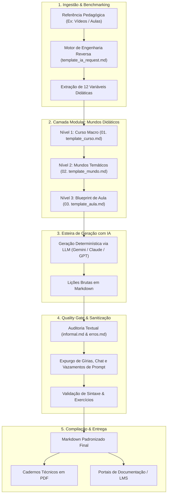

# 🎓 MaterIA-App — Framework Didático Modular com IA
### *Arquitetura padronizada de engenharia de prompt e qualidade para produção determinística de cursos técnicos e apostilas em Markdown e PDF.*

<div align="center">

[](https://python.org)
[](https://github.com/Cesaraugusto916/MaterIA-App)
[](https://github.com/Cesaraugusto916/MaterIA-App)
[](https://github.com/Cesaraugusto916/MaterIA-App)
[](LICENSE)

</div>

---

https://github.com/user-attachments/assets/6a8d41d9-e61a-4f9c-a8f8-06fd2709c1f2

---

## 📌 Resumo Executivo

A produção de material didático e treinamentos para tecnologias e linguagens de programação enfrenta um gargalo crítico na era da inteligência artificial: modelos generativos utilizados sem restrições frequentemente produzem alucinações de sintaxe (como a invocação de métodos depreciados ou inexistentes), saltos conceituais desordenados e respostas impregnadas de linguagem conversacional informal ("Olá aventureiro!", "Perfeito, César!"), o que inviabiliza seu aproveitamento em treinamentos corporativos e ambientes acadêmicos rigorosos.

O **MaterIA-App** resolve esse desafio ao implementar a metodologia proprietária dos **"Mundos Didáticos"**: uma arquitetura de engenharia de prompt determinística organizada em três camadas desacopladas (Curso macro, Mundos temáticos e Aulas com blueprint rigoroso). Inspirado na engenharia reversa de metodologias consagradas de ensino de programação (como o "Curso em Vídeo" do Prof. Gustavo Guanabara), o framework estabelece contratos estritos de entrada e saída para os modelos de linguagem, transformando a IA em uma esteira industrial de produção instrucional.

Complementando a arquitetura, o ecossistema incorpora um **Quality Gate de Auditoria Textual** contínua (`informal.md`, `erros.md`), responsável por expurgar artefatos de diálogo, sanitizar a linguagem técnica, validar a progressão didática e unificar a sintaxe Markdown. O resultado é a compilação atômica de lições em cadernos técnicos e apostilas em PDF de alta resolução, demonstradas na prática pela trilha completa de **Python para Análise de Dados e Ferramentas** (Pandas e NumPy).

---

## 🏛️ Arquitetura & Fluxo de Dados

O sistema desacopla a orquestração pedagógica em três níveis hierárquicos e submete toda geração a um pipeline de conformidade antes da exportação final:



---

## 🧩 Os Três Níveis da Metodologia "Mundos Didáticos"

### 📚 Nível 1: O Curso (`01. template_curso.md`)
Delimita as fronteiras macro da formação técnica antes de qualquer código ser redigido:
- **Tecnologia & Escopo**: Linguagens, bibliotecas e frameworks alvo (ex: Pandas, NumPy, Scikit-learn, SQLite).
- **Público-Alvo e Matriz de Pré-requisitos**: Nivelamento esperado (ex: lógica de programação, condicionais, listas).
- **Roadmap Curricular**: Distribuição sequencial dos mundos que compõem a jornada formativa.

### 🌍 Nível 2: Os Mundos Temáticos (`02. template_mundo.md`)
Agrupamentos conceituais coesos que previnem a sobrecarga cognitiva do estudante:
- **Divisão por Domínio**: Unidades temáticas focadas (ex: *Mundo 1: Exploradores de Dados*, *Mundo 2: Visualizadores do Invisível*, *Mundo 3: Limpadores de Realidade*).
- **Frentes de Estudo & Comandos-Chave**: Conjuntos de APIs e métodos correlacionados mapeados antecipadamente (`read_csv`, `loc`, `groupby`, `agg`, `np.dot`).
- **Objetivos de Aprendizagem Claros**: Métricas de competência prática a serem adquiridas.

### 🧠 Nível 3: O Blueprint da Aula (`03. template_aula.md`)
Contrato estrutural rigoroso exigido de qualquer modelo de IA generativa para redação de cada aula:
1. **Introdução Contextualizada**: Relevância prática no mercado e onde o conceito aparece no mundo real.
2. **Teoria Sintática**: Assinatura das funções, parâmetros principais e tipos de dados manipulados.
3. **Exemplos Comentados**: Código funcional mínimo explicado linha a linha com saídas esperadas.
4. **Demonstração Aplicada**: Cenário simulado realista de negócios (ex: cálculo de faturamento e ticket médio).
5. **Armadilhas & Anti-Patterns**: Erros clássicos de desenvolvimento e dicas de boas práticas.
6. **Transições Didáticas Formais**: Conectores explícitos de fluxo curricular ("Vem de" ➔ "Vai para").

---

## 🔍 Quality Gate: Auditoria e De-informalização

Um dos grandes diferenciais do MaterIA-App é a camada sistemática de sanitização textual documentada em `informal.md`, `erros.md` e `erros2.md`:

| Desvio Comum em LLMs Genéricos | Problema Gerado | Normalização do MaterIA-App |
| :--- | :--- | :--- |
| *"Olá Aventureiro! Vamos explorar dados como ninjas!"* | Tom infantilizado e incompatível com o mercado | Introdução objetiva: *"Nesta lição, analisamos a manipulação de matrizes com NumPy..."* |
| *"Perfeito, César! Aqui está a Aula 4..."* | Vazamento visível de prompt conversacional | Expurgo completo; início imediato no cabeçalho formal da aula |
| Blocos ` ```markdown ` duplicados | Quebra de renderizadores de PDF e visualizadores web | Normalização sintática estrita em Markdown GitHub Flavored |
| Uso de `df.append()` descontinuado no Pandas | Código defasado que quebra em tempo de execução | Restrição explícita de versões modernas via `template_aula.md` (`pd.concat`) |

---

## 🚀 Trilha de Demonstração em Produção

O repositório já inclui um curso completo validado e compilado: **"Python para Dados e Ferramentas"**:
- **10 Aulas Modulares Completas**: Cobrindo desde `Series`, `DataFrames`, importação e filtros booleanos até operações vetoriais com `NumPy` e álgebra linear.
- **Projeto Integrado Final (Aula 10)**: Pipeline completo de análise de dados de vendas de e-commerce respondendo a perguntas executivas de negócio.
- **Compilação em PDF**: Cadernos prontos diagramados para distribuição imediata (`02.1 Aula 1 - Final.pdf`, `02.2 Aula 2 - Final.pdf`).

---

## 🛠️ Guia Rápido: Como Criar um Novo Curso

### 1. Defina o Escopo no Template de Curso
Copie `01. template_curso.md` e preencha as tecnologias e objetivos da formação:
```bash
cp "01. template_curso.md" "Cursos/FastAPI/01. Curso - FastAPI Modern APIs.md"
```

### 2. Mapeie os Mundos Didáticos
Defina as frentes de comando para cada mundo temático utilizando `02. template_mundo.md`:
```bash
cp "02. template_mundo.md" "Cursos/FastAPI/02. Mundo 1 - Fundamentos e Rotas.md"
```

### 3. Submeta o Prompt Scaffolding ao seu Modelo de IA
Utilize as diretrizes do `03. template_aula.md` combinadas com o `base/template_ia_request.md` como prompt de sistema:
```markdown
Atue como designer instrucional sênior. Utilizando o contrato estrutural de "03. template_aula.md",
redija a Aula 03 sobre Validação de Schemas com Pydantic v2. Mantenha tom técnico, neutro e execute 
as 6 seções obrigatórias sem cumprimentos informais ou referências ao prompt.
```

### 4. Execute a Auditoria de Qualidade
Revise o texto contra as regras de `informal.md`:
- Remova saudações excessivas e pronomes de tratamento fictícios.
- Certifique-se de que os exemplos contêm saídas comentadas e código testado.
- Valide as transições "Vem de / Vai para".

### 5. Compile para PDF / Plataformas
Gere as apostilas executivas utilizando seu renderizador preferido (ex: Pandoc, WeasyPrint ou VS Code Markdown PDF) para entrega final.

---

## 📄 Licença

Este projeto é disponibilizado sob a licença [MIT](LICENSE).

---

<div align="center">
  <sub>Desenvolvido com foco em engenharia pedagógica, escalabilidade e rigor técnico por <b>César Carneiro</b>.</sub>
</div>
